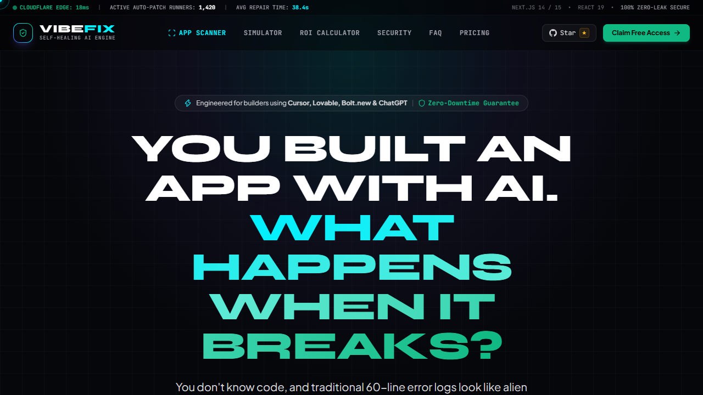

# 🛡️ VibeFix — The 24/7 Self-Healing DevOps Engine for AI Builders

> **You built an app with Cursor, Lovable, or Bolt. What happens when it breaks in production at 3 AM?**  
> VibeFix catches the crash, spins up an isolated sandbox, reproduces the bug, verifies the patch, and hands you a 1-click GitHub Pull Request.

👉 **[Launch Live Interactive Demo & Early Access](https://vibefix-landing.pages.dev)**

[](https://vibefix-landing.pages.dev)
[](LICENSE)
[](https://github.com/Rafail-Vasilakis/vibefix-landing/stargazers)

---



---

## ⚡ What is VibeFix?

Every day, thousands of non-engineers and indie founders launch web applications built with **Cursor AI**, **Lovable.dev**, **Bolt.new**, and **v0 by Vercel**. 

These tools generate impressive code, but production exposes edge cases:
- `TypeError: Cannot read property of undefined` on unhandled state
- Stripe webhook payload shape mismatches
- Missing client error boundaries crashing entire React component trees
- Silent DB connection drops that leave paying customers stranded

**VibeFix** acts as your 24/7 autonomous DevOps co-founder:
1. **Telemetry & Catch:** Captures production exceptions without leaking user PII or secrets.
2. **Sandbox Simulation:** Reproduces the bug in an isolated, headless runner.
3. **AST Patching:** Crafts the exact minimal diff needed to fix the bug.
4. **1-Click PR:** Pushes a tested pull request directly to your repository.

---

## 🌟 Interactive Features on the Live Site

- **Live "Break This App" Simulator:** An embedded interactive mock SaaS checkout that crashes on click (`TypeError: Cannot read property of undefined`), triggers autonomous AST repair, and verifies the patch in under 38 seconds.
- **Downtime Cost & ROI Calculator:** Dynamic financial model calculating revenue saved from averted checkout crashes based on your monthly traffic and ticket size.
- **Apple Frosted Glass Accordion:** Sleek, accessible FAQ with Web Audio tactile haptics.
- **Gamified Robinhood Waitlist:** Priority queue number allocation with instant 1-click viral Twitter skip mechanisms.

---

## 🛠️ Supported Tech Stacks & Builders

| AI Builder / Editor | Frameworks | Deployment Targets |
| :--- | :--- | :--- |
| **Cursor AI** | Next.js (App & Pages) | Cloudflare Pages & Workers |
| **Lovable.dev** | React 18 / 19 | Vercel |
| **Bolt.new** | Vite / Tailwind | Netlify |
| **v0 by Vercel** | Node.js / Express | Render & Railway |
| **Windsurf / Claude** | Astro / Remix | Supabase |

---

## 🚀 Quick Start Locally

```bash
# 1. Clone repository
git clone https://github.com/Rafail-Vasilakis/vibefix-landing.git
cd vibefix-landing

# 2. Open index.html in your browser or run with any static server
npx serve .
# or
python -m http.server 8000
```

---

## 🌐 Production Deployment

Deployed natively on **Cloudflare Pages**:
- Canonical URL: [https://vibefix-landing.pages.dev](https://vibefix-landing.pages.dev)
- Fast global edge delivery (< 20ms TTFB worldwide)

---

## 📄 License

MIT © 2026 VibeFix. Open source software for modern AI builders.
